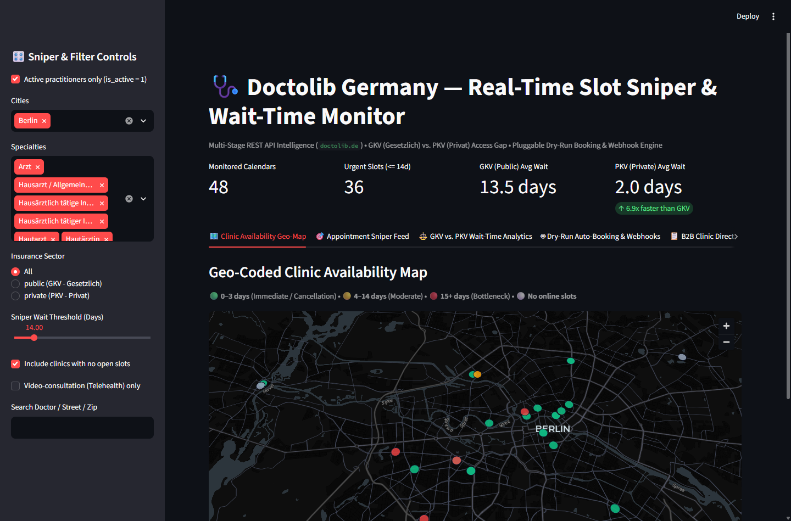
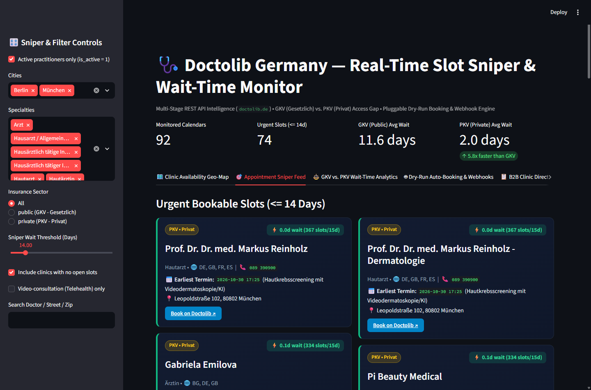
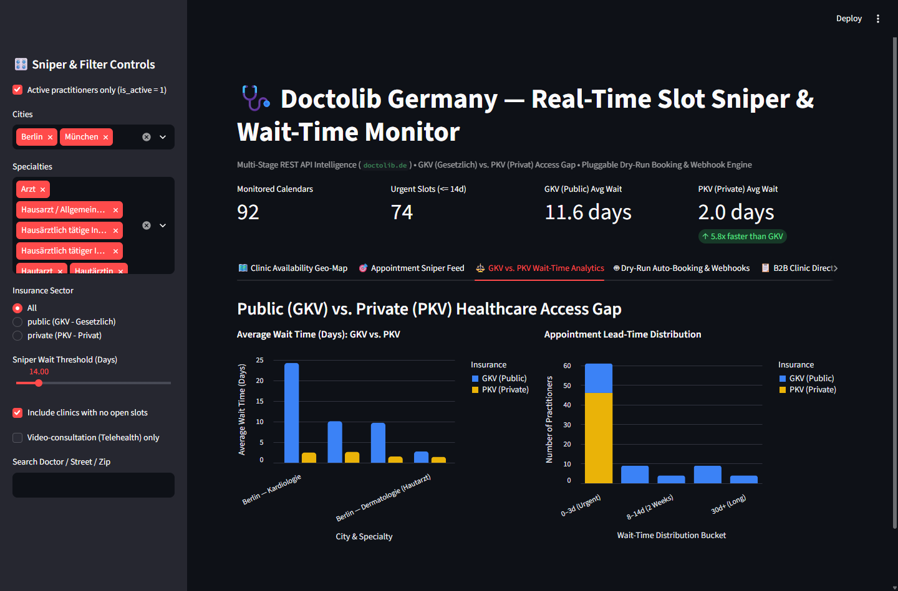
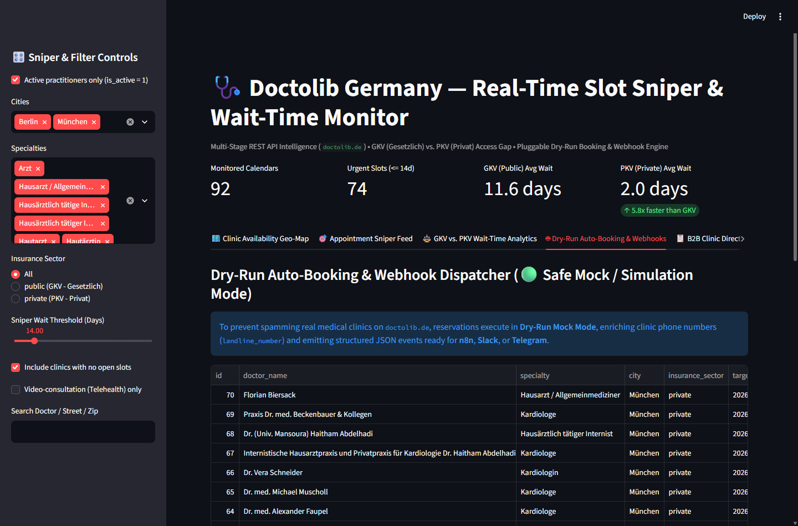
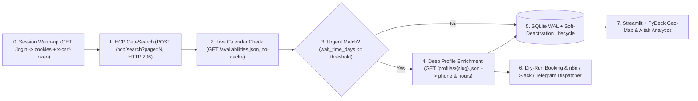

# Doctolib Germany — Real-Time Slot Sniper & Wait-Time Intelligence


Production-grade **HealthTech Appointment Sniper, Geo-Directory & Healthcare Access Analytics Pipeline** for **Doctolib Germany (`doctolib.de`)**.

Instead of relying on slow, resource-heavy headless browsers, this system orchestrates a **4-stage chained REST API pipeline** over `curl_cffi` (Chrome 124 TLS/JA3 impersonation) with automatic Rails CSRF session bootstrapping and strict HTTP anti-cache headers—quantifying the wait-time gap between German **Public (`GKV / Gesetzlich`)** and **Private (`PKV / Privat`)** health insurance while detecting newly opened specialist slots in real time.

---

## UI Showcase (Streamlit + PyDeck Command Center)

### 1. Geo-Coded Clinic Availability Map
Every practitioner and clinic is plotted by GPS coordinates and color-coded by real-time appointment lead time (`Green: 0-3 days`, `Amber: 4-14 days`, `Red: 15+ days`).



### 2. Urgent Appointment Sniper Feed (Phone & Deep-Link Enriched)
Urgent matches are automatically enriched via `/profiles/{slug}.json` with direct clinic landline phone numbers, spoken languages, earliest slot timestamps, and 1-click booking links.



### 3. Public (GKV) vs. Private (PKV) Wait-Time Analytics
Side-by-side empirical comparison of specialist wait times across German cities and insurance sectors.



### 4. Pluggable Dry-Run Auto-Booking & n8n / Webhook Console
Ethical `Dry-Run Mock` reservation engine emitting standardized `BookingIntentPayload` JSON events ready for **n8n**, **Slack**, or **Telegram** workflows.



---

## Sample Live Benchmark Findings (Berlin & Munich)

| City | Specialty | PKV (Private) Avg Wait | GKV (Public) Avg Wait | Access Multiplier |
| :--- | :--- | :---: | :---: | :---: |
| **Berlin** | **Kardiologie** | `2.5 days` | `24.2 days` | **9.7x faster (PKV)** |
| **München** | **Dermatologie (Hautarzt)** | `1.5 days` | `9.7 days` | **6.5x faster (PKV)** |
| **München** | **Kardiologie** | `2.7 days` | `10.1 days` | **3.7x faster (PKV)** |
| **Berlin** | **Dermatologie (Hautarzt)** | `1.4 days` | `2.8 days` | **2.0x faster (PKV)** |

*(Full CSV & JSON sample exports are available under [`data/samples/`](data/samples/).)*

---

## System Architecture



### Key Engineering Highlights
- **Dynamic Cookie-Free Bootstrap:** Automatically seeds `_doctolib_session` and Cloudflare `__cf_bm` cookies and extracts `<meta name="csrf-token">` without hardcoded expiring browser cookies.
- **Anti-304 Cache Busting:** Strips conditional ETag headers (`If-None-Match`) and enforces `Cache-Control: no-cache, no-store, must-revalidate` to prevent stale CDN responses.
- **SQLite WAL & Non-Destructive Lifecycle:** Uses SQL Window CTEs (`ROW_NUMBER() OVER (PARTITION BY profile_id, practice_id, insurance_sector ORDER BY id DESC)`) for zero-duplicate views and soft-deactivation (`is_active = 0`) instead of `DELETE`.
- **Safe Mock Fallbacks:** Runs cleanly out-of-the-box without external API credentials (`Simulation Mode` for n8n/Slack/Telegram alerts and `DRY_RUN_MOCK` for reservations).

---

## Quick Start

### 1. Setup Environment (`uv`)
```bash
git clone https://github.com/Doginnet/doctolib-monitor.git
cd doctolib-monitor
cp .env.example .env
uv sync
```

### 2. Run CLI Slot Sniper & Wait-Time Sweep
```bash
# Compare GKV (public) vs. PKV (private) Cardiology slots in Berlin with Mock Auto-Booking
uv run python -m src.main --city berlin --specialty kardiologie --insurance both --max-doctors 20 --sniper-days 7 --auto-book-mock --notify

# Run multi-city benchmark sweep (Berlin, München, Hamburg)
uv run python -m src.main --ci-sweep --insurance both --max-doctors 20 --auto-book-mock --notify
```

**Supported German City Presets:** `berlin`, `muenchen`, `hamburg`, `koeln`, `frankfurt`, `stuttgart`, `duesseldorf`, `leipzig`.  
**Curated Specialty Slugs:** `hautarzt`, `kardiologie`, `augenheilkunde`, `radiologe`, `orthopadie`, `neurologie`, `allgemeinmedizin`, `urologie`, `frauenarzt`, `zahnmedizin`.

### 3. Launch Interactive Geo-Map Dashboard
```bash
uv run streamlit run src/dashboard/app.py
```

### 4. Run Automated Tests
```bash
# Fast offline unit suite (Pydantic v2 contracts, SQLite WAL lifecycle, Sniper & Mock webhooks)
uv run pytest -m unit -v

# Live network smoke test against doctolib.de
uv run pytest -m live -v
```

---

## Project Structure

```text
doctolib-monitor/
├── .github/workflows/
│   └── scraper.yml                # Daily scheduled CI/CD sweep & flat-data auto-commit
├── assets/                        # Streamlit + PyDeck UI showcase screenshots
├── config/
│   ├── cities.py                  # Bounding-box presets for 8 German cities & specialties
│   └── settings.py                # Pydantic BaseSettings configuration
├── data/
│   ├── doctolib.db                # SQLite WAL relational database
│   └── samples/                   # Clean CSV/JSON exports per city/specialty & global summary
├── src/
│   ├── alerts/dispatcher.py       # n8n Webhook, Slack & Telegram dispatcher (Mock-safe)
│   ├── booking/automator.py       # SniperRule evaluator & DryRunBookingAutomator
│   ├── core/client.py             # ResilientHttpClient (curl_cffi Chrome 124 + CSRF refresh)
│   ├── dashboard/app.py           # 5-tab Streamlit + PyDeck Geo-Map & Altair Analytics UI
│   ├── extractors/doctolib.py     # 4-stage chained Doctolib Germany REST API extractor
│   ├── models/                    # Strict Pydantic v2 schemas (search, availability, profile, booking)
│   ├── pipelines/                 # SQLite WAL storage & CSV/JSON sample exporter
│   └── main.py                    # Rich CLI runner & live terminal analytics tables
├── tests/
│   ├── fixtures/                  # Archived real doctolib.de JSON fixtures
│   ├── test_unit.py               # Offline unit tests
│   └── test_live.py               # Live smoke test
├── .env.example
└── pyproject.toml
```
