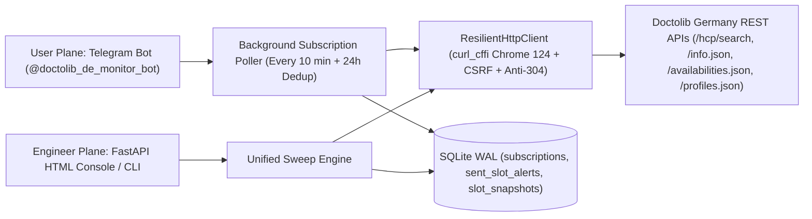
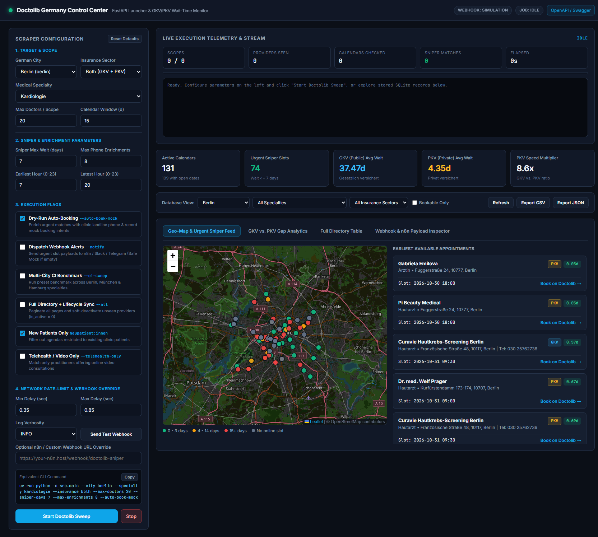

# Doctolib Germany — Real-Time Appointment Monitor & Wait-Time Intelligence


Production-grade **HealthTech Appointment Monitor, Telegram Slot Alert Bot & Healthcare Access Analytics Pipeline** for **Doctolib Germany (`doctolib.de`)**.

Instead of relying on heavy headless browsers, this system orchestrates a **5-endpoint chained REST API pipeline** over `curl_cffi` (Chrome 124 TLS/JA3 impersonation) with automatic Rails CSRF session bootstrapping and strict HTTP anti-cache headers. It serves two complementary interfaces:
1. **Primary User Product — Telegram Bot (`@doctolib_de_monitor_bot`):** Patients subscribe in 4 taps (either by **City + Specialty** or by **pasting a specific Doctor URL & selecting an exact procedure**) and receive instant push deep-links when cancelled **GKV (Public)** or **PKV (Private)** appointments open up.
2. **Under-the-Hood Engineer Console — FastAPI + HTML Control Center:** Standalone web control plane exposing all scraper parameters, execution flags, live telemetry, Leaflet clinic geo-map, and **GKV vs. PKV** wait-time gap analytics.

---

## Dual-Interface Architecture



### 1. User Plane: Telegram Subscription Bot (`src/main.py`)
- **Mode A — City & Specialty Watch:** Monitor top clinics in 8 German cities across 12 high-demand specialties filtered by insurance (`GKV` / `PKV`), maximum wait horizon (`3 / 7 / 14 / 30 days`), and preferred time of day (`Morning / Midday / Evening / Any`).
- **Mode B — Specific Doctor & Exact Procedure Watch:** Paste any `https://www.doctolib.de/...` profile URL into the chat. The bot queries `/online_booking/api/slot_selection_funnel/v1/info.json` to render that doctor's real procedures (`visit_motives`) as interactive buttons.
- **Zero-Spam 24h Deduplication:** Every delivered alert is indexed in `sent_slot_alerts` (`subscription_id, profile_id, practice_id, slot_iso`) so users never receive repeated notifications for the same slot.
- **1-Click Deep-Link Booking:** Alerts include a direct `Book Now on Doctolib ->` button (opening straight in the user's authenticated Doctolib mobile session without exposing patient credentials or 2FA codes) plus a `Booked / Stop This Alert` button.

### 2. Engineer Plane: Standalone FastAPI + HTML Control Center (`src/web/api.py`)
Designed for scraping engineers and data analysts to tune rate limits, run multi-city `GKV vs. PKV` benchmarks, inspect webhook payloads, and explore geo-coded clinic lead times.



<details>
<summary>Expand additional Streamlit + PyDeck analytics views</summary>

#### Geo-Coded Clinic Availability Map


#### Urgent Appointment Sniper Feed


#### Public (GKV) vs. Private (PKV) Wait-Time Analytics


#### Webhook & n8n Payload Console


</details>

---

## Sample Live Benchmark Findings (Berlin & Munich)

| City | Specialty | PKV (Private) Avg Wait | GKV (Public) Avg Wait | Access Multiplier |
| :--- | :--- | :---: | :---: | :---: |
| **Berlin** | **Kardiologie** | `2.5 days` | `24.2 days` | **9.7x faster (PKV)** |
| **München** | **Dermatologie (Hautarzt)** | `1.5 days` | `9.7 days` | **6.5x faster (PKV)** |
| **München** | **Kardiologie** | `2.7 days` | `10.1 days` | **3.7x faster (PKV)** |
| **Berlin** | **Dermatologie (Hautarzt)** | `1.4 days` | `2.8 days` | **2.0x faster (PKV)** |

*(Full CSV & JSON sample exports are available under [`data/samples/`](data/samples/).)*

---

## Quick Start & Entrypoints

### 1. Setup Environment (`uv`)
```bash
git clone https://github.com/Doginnet/doctolib-monitor.git
cd doctolib-monitor
cp .env.example .env
uv sync
```

Edit `.env` to configure your Telegram Bot token and polling cadence:
```ini
TELEGRAM_BOT_TOKEN=your_botfather_token_here
BOT_POLL_INTERVAL_MINUTES=10
BOT_MAX_DOCTORS_PER_SEARCH=15
BOT_ALERT_DEDUP_HOURS=24
```

### 2. Run Primary Service (Telegram Bot + 10-Min Background Poller)
```bash
uv run python -m src.main
# Or via script alias:
uv run doctolib-bot
```

### 3. Launch Standalone Scraper Engineer Console (FastAPI + HTML)
```bash
uv run doctolib-web
# Opens on http://127.0.0.1:8000 (Swagger API docs at http://127.0.0.1:8000/docs)
```

### 4. Run Standalone CLI Benchmark Sweeps
```bash
# Single city GKV vs. PKV comparison
uv run doctolib-cli --city berlin --specialty kardiologie --insurance both --max-doctors 20

# Multi-city CI benchmark sweep (Berlin, München, Hamburg)
uv run doctolib-cli --ci-sweep --insurance both --max-doctors 20
```

### 5. Optional Secondary Streamlit Dashboard
```bash
uv run streamlit run src/dashboard/app.py
```

---

## Testing Architecture

The test suite is split into deterministic offline tests (`@pytest.mark.unit`, including full Telegram Bot & Poller mock tests) and live network smoke verification (`@pytest.mark.live`):

```bash
# Offline unit & Telegram Bot mock tests (0 external network calls, ~1s)
uv run pytest -m unit -v

# Live end-to-end smoke test against doctolib.de (all 5 chained endpoints)
uv run pytest -m live -v
```

---

## Project Structure

```text
doctolib-monitor/
├── .github/workflows/
│   └── scraper.yml                # Daily scheduled CI/CD sweep & flat-data auto-commit
├── assets/                        # FastAPI Control Center & Streamlit showcase screenshots
├── config/
│   ├── cities.py                  # Bounding-box presets for 8 German cities & 12 specialties
│   └── settings.py                # Intuitive Pydantic BaseSettings (.env) configuration
├── data/
│   ├── doctolib.db                # SQLite WAL relational database
│   └── samples/                   # Clean CSV/JSON exports per city/specialty & global summary
├── src/
│   ├── alerts/dispatcher.py       # Optional n8n Webhook & Slack event forwarder
│   ├── booking/automator.py       # CLI/Engineer SniperRule evaluator
│   ├── bot/
│   │   ├── poller.py              # Async 10-min SubscriptionPoller & 24h slot deduplicator
│   │   └── telegram_bot.py        # Interactive Telegram Bot (City/Specialty & Doctor URL wizards)
│   ├── core/client.py             # ResilientHttpClient (curl_cffi Chrome 124 + CSRF + anti-cache)
│   ├── dashboard/app.py           # Optional Streamlit + PyDeck analytics UI
│   ├── extractors/doctolib.py     # 5-endpoint Doctolib Germany REST API extractor
│   ├── models/                    # Pydantic v2 schemas (search, funnel, availability, profile, booking)
│   ├── pipelines/                 # Sweep runner, SQLite WAL storage & CSV/JSON exporter
│   ├── web/                       # Standalone FastAPI server & HTML Engineer Control Center
│   ├── cli.py                     # Standalone headless CLI scraper runner
│   └── main.py                    # Primary entrypoint: Telegram Bot + Background Poller
├── tests/
│   ├── fixtures/                  # Archived real doctolib.de JSON fixtures (incl. booking funnel)
│   ├── test_bot_mocks.py          # Offline mock tests for Telegram Bot commands, wizards & poller
│   ├── test_unit.py               # Offline unit tests for Pydantic models, SQLite WAL & FastAPI
│   └── test_live.py               # Live 5-endpoint smoke test against doctolib.de
├── .env.example
└── pyproject.toml
```
